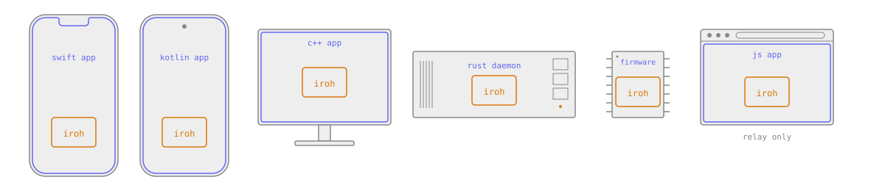
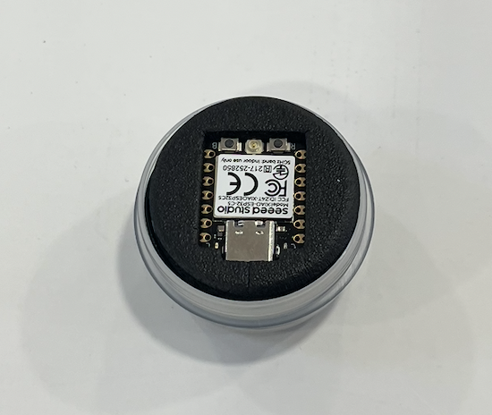
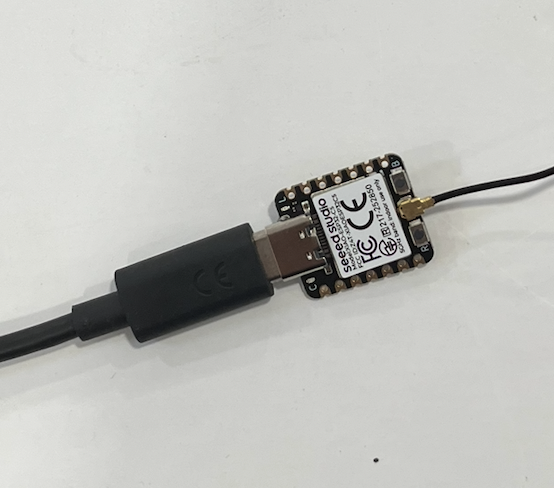

<!-- center -->

# iroh on ESP32

Rüdiger Klaehn

n0.computer

---

<!-- center -->

iroh is a library for **direct** **QUIC** connections between endpoints identified and encrypted using ed25519 **keypairs**

---

<!-- center -->

iroh is **QUIC**, but **p2p**

---

# Iroh is p2p QUIC

- a library for **direct QUIC connections**
- works pretty much everywhere
- Rust, with bindings for C, C++, JS, Python, Swift, Go
- Browser works with caveats, but isn't main focus



---

# What makes iroh QUIC connections p2p?

- dial by **key**
- **direct** connections via hole punching

---


---

# Iroh architecture


---

# Why QUIC?

- No head of the line blocking between streams
- Stream priorities
- QUIC streams are very cheap



---

# Why hole punching inside QUIC?

- One set of cryptographic primitives
- Use QUIC retransmit logic for coordination frames
- HP frames invisible to middleboxes

---

# Hole punching



---

# Workshop: iroh on an ESP32

- Five small steps, from a bare endpoint to a lamp you control from a web page
- Each step is its own program: jump in anywhere

What you need:

- Rust, `espflash` and `ldproxy`
- A browser; Chrome or Edge for step 5 (Web Bluetooth)
- [github.com/n0-computer/iroh-workshop-esp32](https://github.com/n0-computer/iroh-workshop-esp32)

---

# The device

- A Seeed Studio XIAO ESP32-C5, with its antenna
- A USB-C cable that carries data



---

# Plug in the antenna

- The board comes with an external antenna on a tiny **U.FL** connector
- Press it on straight until it clicks
- Without it, WiFi barely works:

```
Failed to connect to WiFi: ESP_ERR_TIMEOUT (error code 263)
```



---

# WiFi

The venue network is open, so just the SSID:

```sh
export WIFI_CONFIG=UPB-Guest
```

- Read at build time, so set it before `cargo run`
- Your own phone hotspot is welcome too: `WIFI_CONFIG='ssid:password'`

---

# Step 1: an endpoint

```rust
let endpoint = iroh::Endpoint::bind(esp32::N0)
    .await
    .expect("Failed to bind the endpoint");
info!("Hello from iroh! My endpoint id is {}", endpoint.id());

let _router = Router::builder(endpoint).spawn();
```

- Join WiFi, bind an endpoint, print its **endpoint id**: the public key to dial
- A new random id on every start
- **Page 1**: the device answers, but turns you away: no protocols yet

```sh
cd 01-hello && WIFI_CONFIG='ssid:password' cargo run --release
```

---

# Step 2: a stable endpoint id

```rust
let secret_key = esp32::load_or_create_secret_key(board.nvs);

let endpoint = iroh::Endpoint::builder(esp32::N0)
    .secret_key(secret_key)
    .bind()
    .await
    .expect("Failed to bind the endpoint");
```

- The secret key is generated once and kept in flash (NVS)
- The endpoint id survives restarts and reflashing
- **Page 2**: paste the id once, the pages remember it

---

# Step 3: a protocol

```rust
pub const ALPN: &[u8] = b"iroh-esp32-workshop/light/1";

#[rpc_requests(message = LightMessage)]
#[derive(Debug, Serialize, Deserialize)]
pub enum LightProtocol {
    #[rpc(tx = oneshot::Sender<bool>)]
    Set(Set),
    #[rpc(tx = oneshot::Sender<bool>)]
    Get(Get),
}
```

- One enum, shared by the device and the page; [irpc] does the wire format
- The **ALPN** names the protocol, like a port number
- **Page 3**: switch the LED

---

# Step 4: watching

```rust
/// Get the current state, then every change, until you hang up.
#[rpc(tx = mpsc::Sender<bool>)]
Watch(Watch),
```

```rust
let changed = tokio::select! {
    Some(request) = requests.recv() => match request { ... },
    _ = check_button.tick() => { ... },
};
```

- The BOOT button toggles the light: state changes without anyone asking
- Protocol version 2, with its own ALPN, adds `Watch`
- **Page 4**: press the button, watch the light follow

---

# Step 5: a lamp (demo)

- **WiFi provisioning over Bluetooth**, no `WIFI_CONFIG`
  - credentials sealed with HPKE to the endpoint id: only this device can read them
  - answers with a pairing ticket, so the page can connect right away
- A push button: press to switch, hold to toggle automatic mode
- A photoresistor: in automatic mode, on when it gets dark
- Protocol version 3: on/off, mode, brightness, threshold
- **Page 5** (Chrome or Edge, for Web Bluetooth)

---

# Read more

- [github.com/n0-computer/iroh-workshop-esp32](https://github.com/n0-computer/iroh-workshop-esp32)
- [blog](https://iroh.computer/blog)
- [docs.rs/iroh](https://docs.rs/iroh)
- [github.com/n0-computer/iroh](https://github.com/n0-computer/iroh)

[irpc]: https://docs.rs/irpc
